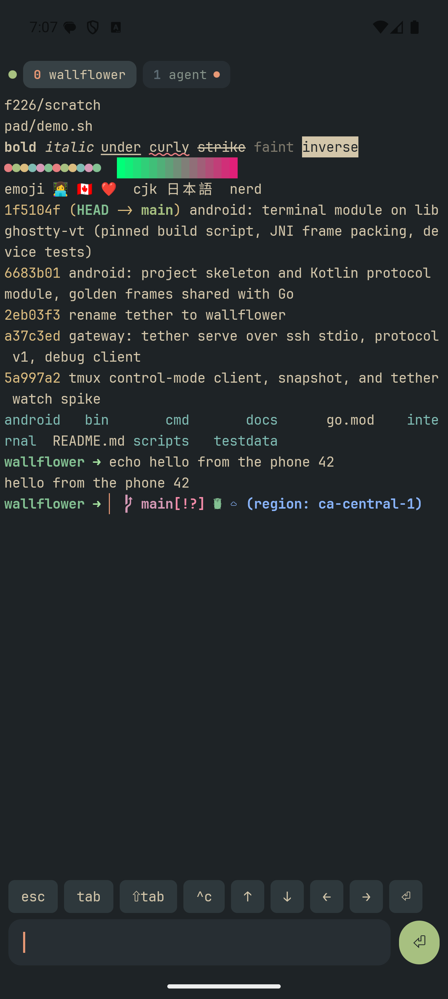

# wallflower

A phone-first shell around your terminal. Your multiplexer stays the
server (tmux or Rex); a small gateway on the computer (macOS or Linux)
drives it and serves a lean, versioned protocol to clients (an Android app first) over SSH. How it fits
together, and where multiplexers and programs plug in:
[docs/architecture.md](docs/architecture.md). Programs beyond the built-in
ones (Claude Code, shells) can have plugins of your own:
[docs/plugins.md](docs/plugins.md).

```
phone app ──ssh stdio──▶ wallflower serve (one per connection) ──tmux -C──▶ tmux server
```

## Set up

On the computer (macOS or Linux):

```sh
curl -fsSL https://github.com/ahmd-sh/wallflower/releases/latest/download/install.sh | sh
```

or, with the binary in hand, `./wallflower-linux-amd64 setup`. Setup puts
wallflower in `~/.local/bin`, checks for tmux, an ssh server and Tailscale,
offers to install or start what's missing, and shows a QR code. Scan it in
the app (Tailscale on the phone too, same account) and it connects. To pair
another phone later: `wallflower pair`. `wallflower devices` lists the
phones that can connect, and `wallflower revoke` takes one out.

`scripts/release.sh vX.Y.Z` builds the binaries, checksums and installer
into `dist/release` (`-publish` makes the GitHub release).

## Status

The gateway works end to end. The Android app (`android/`) renders live panes
with libghostty-vt, with window tabs, native scrollback, a composer, mobile
views of the programs that have one, and the sessions of every multiplexer;
it connects over SSH (Tailscale), or a development TCP transport.

 The wire format is
[docs/protocol.md](docs/protocol.md), pinned by golden frames in `testdata/`
that both the Go and Kotlin tests check.

```sh
go build -o bin/wallflower ./cmd/wallflower
bin/wallflower debug -cols 56 -rows 20                        # local gateway as JSON lines
bin/wallflower debug -- ssh mac "wallflower serve"            # through ssh
bin/wallflower watch -output=false                            # raw control-mode events
```

Requires tmux 3.8 (JSON layouts, floating panes), or on macOS Rex (`serve -mux rex`,
which finds Rex.app's server, or `-rex` names a socket).

```sh
scripts/build-libghostty.sh          # once, and after bumping GHOSTTY_COMMIT
cd android && ./gradlew :protocol:test :app:assembleDebug
./gradlew :terminal:connectedDebugAndroidTest   # needs a device or emulator

# develop against an emulator, with a throwaway tmux server
bin/wallflower listen -L demo        # loopback only, no auth
adb reverse tcp:41777 tcp:41777
```

## tmux control mode notes

- Command replies are `%begin`/`%end` blocks whose last field is 1 for
  commands this client sent, 0 for the attach itself.
- `-f new-layouts` makes `%layout-change` use the JSON layout format; floating
  panes are pane cells with a `z` order. `#{window_layout}` is JSON regardless.
- `-f ignore-size` keeps a watching client from resizing windows.
- `read-only` only blocks keys; commands sent on stdin still run.
- Floating pane sizes from `new-pane -x/-y` include the border.
- `%session-renamed` carries `$id name`, despite the man page.
- Subscriptions (`refresh-client -B`) report current values on subscribe,
  then changes at most once a second.
- Each command in a `;` list gets its own reply block, and a parse error is
  one block for the whole line, so the client ends every line with a marker
  command. Commands in one line run back to back: an atomic read.
- Without a UTF-8 locale tmux replaces tabs and non-ASCII in replies with
  `_`; `-u` forces UTF-8. It assumes UTF-8 whenever `$TMUX` is set.
- A control client only affects window size after `refresh-client -C`.
  Re-sending the same size doesn't reclaim a window; `select-window` does.
- With an alternate screen active, `capture-pane` shows it; `-a` shows the
  normal screen behind it, and `-S -N -E -1` the normal screen's history.
- `capture-pane -e` carries attributes across lines.
